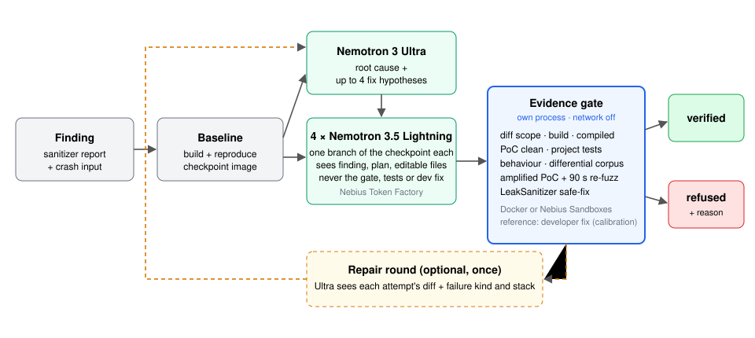

# Leakproof

[](https://github.com/samsundar989/nebius-hackathon/actions/workflows/ci.yml) [](LICENSE)

**Live dashboard** (link when deployed) · **3-minute video** (link when recorded) · **Devpost** (link when submitted)

> **In 60 seconds**
> - **What it does:** fixes memory-safety bugs in C, C++ and CUDA, and reports a fix only when a separate, offline evidence gate verifies it.
> - **The aha:** a patch for a real jq bug passed jq's own tests; Leakproof doubled one number in the crash input, the patched jq overflowed, and the patch was refused.
> - **Proof:** 15/27 real OSS-Fuzz bugs verified · 14 correct when compared with the developers' fixes · the gate accepts 24/27 of the developers' own fixes.
> - **Which model does what:** Nemotron 3 Ultra plans and four Nemotron 3.5 Lightning workers patch; on real bugs Ultra's plan takes the same workers from 2 to 7 verified fixes out of 10.
> - **Try it:** `uv run leakproof fix --config examples/csvsplit/leakproof.toml` (Docker and a Nebius Token Factory key; about one cent). The [walkthrough](docs/WALKTHROUGH.md) goes from `init` to a ready-to-send patch, with real outputs.

**Verified fixes, or nothing.** Leakproof is an agent that fixes memory-safety defects in C, C++ and CUDA code — leaks, use-after-free, double free, buffer overflows, data races — and reports a fix only when an evidence gate verifies it. On Nebius Token Factory, Nemotron 3 Ultra plans, Nemotron 3.5 Lightning patches, and Nemotron 3 Super attacks every candidate on projects without tests; a separate gate process, with the network off, decides.

> **jq, OSS-Fuzz bug 42530604.** The model's patch passed jq's own test suite and stopped the original crash.
> Leakproof doubled the longest run of digits in the proof-of-concept input, and the patched jq overflowed a heap buffer in `decToString`.
> The unpatched program and the developer's real fix are both clean on that input, so the patch was refused.
> In another run, a one-line buffer-size fix passed every check and was verified.

It is for maintainers of C/C++ projects that fuzz: OSS-Fuzz alone reports having helped find and fix "over 13,000 vulnerabilities and 50,000 bugs across 1,000 projects" as of May 2025 ([OSS-Fuzz README](https://github.com/google/oss-fuzz)). A fix that only silences the crash is the known failure mode: PatchBench finds that checking only the original proof-of-concept inflates repair agents' solve rates by 1.83× on average ([arXiv 2609.04075](https://arxiv.org/abs/2609.04075)). Its cases and validation differ from ours, so that figure is context, not a comparison.

Every number below is generated from run records by scripts; the full tables are in [docs/NUMBERS.md](docs/NUMBERS.md). Two evidence bundles show what the output looks like: [a verified fix](docs/bundles/42520955.md) (mosquitto: equivalent to the developer's fix, with the two verified-but-wrong candidates it was chosen over) and [a refusal](docs/bundles/42530604.md) (jq).

## The problem

Sanitizers and fuzzers find memory bugs faster than teams can fix them: a project can sit on hundreds of open reports. LLMs can write patches, but most "fixes" only make the crash go away — clamp a bound, skip a code path, allocate one more byte — and a repair loop that stops at "the sanitizer is quiet" reports those as successes. Leakproof's job is the opposite: say "fixed" only with evidence a reviewer can check, and say "refused, here is why" otherwise.

## Results

| | cases | crash gone ("raw") | **verified** | verified and correct | model $ per verified fix |
|---|---|---|---|---|---|
| ARVO — real OSS-Fuzz bugs in 13 projects, run 1 | 27 | 18 | **15** | **14** | $0.070 |
| Juliet CWE-401 sample (synthetic) | 100 | 94 | **94** (every reproducible case) | – | $0.011 |
| CUDA on a Kaggle T4 (compute-sanitizer) | 3 | 3 | **3** | – | $0.007 |

- **The gap between "crash gone" and "verified" is the point.** On ARVO, candidates made the proof-of-concept stop crashing in 18 cases; 3 of those were still not fixed: re-fuzzing with enlarged inputs found a crash the developer's real fix does not have (libplist, jq, libical).
- **"Verified" is not yet "correct", so we measure the difference.** Every distinct verified ARVO diff (67, across all runs) was compared with the developer's fix: Nemotron 3 Ultra classified each one, then each was reviewed by hand. **52 of 67 (78%) are correct** (equivalent or a different correct fix), 7 are defensive (safe, but they guard the symptom) and 8 are wrong (no crash on any input tried, but a residual over-read or changed behaviour). This is the gate's precision. Per case, the chosen fix is correct in 14 of the 15 verified cases.
- **Choosing among several verified fixes matters.** When more than one candidate verifies, Ultra compares them pairwise ("which preserves the original intent", asked in both orders), with diff size as the last tiebreak. The old rule, smallest diff, picked a wrong fix in 3 of 20 such cases; the pairwise review replaced all 3 with a correct one and never the reverse.
- **Bugs that are still open upstream.** On 30 open GitHub issues with sanitizer reports in small C projects (two rounds), Leakproof attempted the 7 that still reproduce at upstream HEAD and have no fix PR, verified a fix for 5, and after review **1 is ready to propose** (toybox #572: a one-line fix that passes toybox's own 13 `patch` tests; [review](cases/open_bugs/REVIEW.md)). Without project tests or an output-printing harness the gate can only check the reproducer, and most verified diffs turned out defensive or incomplete on review. That is why every fix goes to a human first; nothing was posted upstream. $0.92 in total.
- **Runs:** run 1 verified 15/27. Run 2 (edit fallbacks plus one repair round) stopped at its spending cap after 18 cases and verified 9 of them (run 1: 8 of the same 18). Verified in either run (pass@2): 18/27. That is two attempts, not a single-run rate.
- **The gate accepts the developers' own fixes**: 24 of 27 upstream fix commits verify when run through the identical gate; one more is rejected *correctly* — it leaks (mosquitto, the leak is allocated on a line that fix adds); 2 are false rejects (7.4%), both from known limits listed below. Raw before review: 24/33.
- **CUDA:** of four candidate patches for an out-of-bounds write, two silenced compute-sanitizer — one clamped the bound, one allocated an extra element — and printed the wrong checksum. Only the output check caught them.
- **Ultra's diagnosis** names a file the developer changed in 22 of 24 ARVO cases (a proxy measure; see NUMBERS.md).

## How it works



Text version:

```
finding ──► baseline build + reproduction (ASan/LSan/UBSan, or compute-sanitizer)
        ──► Nemotron 3 Ultra: root cause + up to 4 fix hypotheses
        ──► 4 × Nemotron 3.5 Lightning workers, each on its own branch of the baseline checkpoint
        ──► the gate, in its own process, network off  ──►  verified | refused (with the reason)
                                                  └─ no verified fix? one repair round: Ultra sees
                                                     each attempt's diff and why it failed
```

Workers see the finding, the plan and the source files they may edit — never the gate's corpus, fuzzing settings, tests, or the developer's fix. A test fails if any module on the worker path imports gate code.

## The evidence gate

A candidate is **verified** only if every check passes:

| check | what it rejects |
|---|---|
| unpatched trips | a baseline that does not reproduce the bug (nothing to judge) |
| diff scope | edits to tests, build files, the fuzz harness (found by content, not directory), sanitizer options, added `exit`/`abort`, allocator tricks |
| build + "compiled" | a build that skipped the edited file: the harness binary's hash must change |
| patched | the proof-of-concept still crashes, or now crashes differently |
| project tests | the project's own suite fails (Juliet: the good-path build stays clean) |
| behaviour | output changed on the reproducer (Juliet, CUDA checksums) |
| differential corpus | a corpus input that ran clean now crashes or changes its exit code or output |
| amplified re-fuzz | enlarged copies of the PoC (every digit/letter run ×2/×8/×64, the whole input, the last element) and 90 s of libFuzzer find a crash the developer's fix does not have |
| safe-fix | the corpus under LeakSanitizer shows a leak, use-after-free or double free the reference does not |

**Projects without a fuzz harness** (most open-source C, and every open bug we tried): the gate generates inputs from the PoC — an amplified copy, 8 truncations and 200 seeded mutations — and runs the project's own reproduce command on each, patched and unpatched. The target crash on any of them rejects the patch (`rejected:refuzz_same_bug`); a new crash, or a changed exit status or output on an input that ran clean unpatched, fails the re-fuzz or behaviour check. On the open bugs this caught one of five wrong-or-incomplete fixes a human review had found (toybox #571) and rejected none of the correct ones ([REVIEW](cases/open_bugs/REVIEW.md#review-finding--caught-by-which-check-d-0078-re-gate)).

**How a gate lies — bugs we found in our own gate and fixed** (each in [docs/DECISIONS.md](docs/DECISIONS.md)):
- *The patch was never compiled.* Copied-in sources had older timestamps than the objects, so `make` skipped them; the gate "verified" the unpatched binary. Now the harness hash must change.
- *The fuzzer never ran.* ARVO hard-codes AFL/honggfuzz engines; our libFuzzer flags were silently ignored and re-fuzzing "passed" with zero executions. Now every build uses libFuzzer and a run with no executions is inconclusive.
- *A slow input counted as a crash.* A libFuzzer `slow-unit` file rejected a correct fix.
- *Line numbers moved.* A pre-existing bug two lines below the developer's edit was blamed on the fix; crashes are now compared by kind + function + file.
- *The model could edit the harness.* Harnesses outside `fuzz/` directories were editable; files defining the fuzz entry point are now off limits wherever they live.
- *Build scripts run once.* OSS-Fuzz `build.sh` scripts fail the second time (`mkdir build`), so every candidate "failed to build".
- *The harness can only see what it prints.* mosquitto 42520955: `realloc` moves the listener array and leaves `config->default_listener` dangling. The developer saves the default listener's **index** before the `realloc` and restores the pointer after it. Two of three verified candidates point it at the **new** listener instead:

  ```diff
  +	if(config->default_listener){
  +		config->default_listener = &config->listeners[config->listener_count-1];
  +	}
  ```

  Neither crashes, and every input ran the same as the baseline, because the config-parsing harness never prints which listener got which settings, and the project's tests could not run in the image. Both are wrong: the default listener's settings land on the wrong listener. The gate's "verified" means *safe on every input we tried*, not *correct*. So every verified ARVO fix is also compared with the developer's fix (Ultra's classification, then a human review), and the stricter "verified and correct" tier is reported next to it (see Results). This is not special to mosquitto: in 26 of the 27 ARVO cases we measured, the fuzz harness prints nothing, so on real OSS-Fuzz code the corpus comparison sees only exit codes and crashes. Every verified fix carries an evidence label (did the project's tests run; does the harness output vary), and fixes where the gate observed neither are marked "verified, needs human review". The label does not separate correct fixes from wrong ones, because the tests that ran do not cover these defects ([NUMBERS](docs/NUMBERS.md#what-could-the-gate-observe-evidence-strength-d-0074)).

The gate was calibrated on the developers' own fixes after each change; the numbers above are from the final gate.

## How we use NVIDIA Nemotron

| model (Nebius Token Factory) | role |
|---|---|
| Nemotron 3 Ultra | root cause and fix hypotheses; repair round with each attempt's failure and the whole hot files; ranking of several verified fixes; advisory comparison with the developer's fix (evaluation only) |
| Nemotron 3.5 Lightning | the four parallel workers that write edits; advisory reviewer notes |
| Nemotron 3 Super | alternative planner (leaderboard) |

On the synthetic Juliet subset the planner barely matters (Lightning-only 93%, Ultra 95%, Super 93% verified). **On real code it does:** on 10 calibrated ARVO cases, workers without a plan verified 2, with Super 4, with Ultra 7 (verified and correct: 2, 3, 5). Ultra was also cheaper per verified fix than no planner ($0.059 vs $0.112), because failed attempts cost money too (one repeat; see NUMBERS.md). Ultra also ranks candidates when several verify, and drafts the advisory comparison with the developer's fix that our review starts from. The advisory reviewer flags verified and rejected candidates at about the same rate, so it is shown as notes and never counted as evidence.

## How we use Nebius

- **Token Factory** for every model call, with thinking control and structured outputs. Every call is metered into a cost ledger; on 2026-10-24 the ledger's model spend ($3.28) matched the billing page ($3.27).
- **Sandboxes** (beta) through a small REST client: the gate runs with `networking.enabled=false`, workers branch from one saved checkpoint, and each case records its checkpoint lineage. The Juliet runs used it (100 reproductions in 41 s, 8 in parallel). ARVO images do not import yet (`NotImplementedError: chmod: follow_symlinks unavailable on this platform`), so ARVO runs on local Docker — details in [docs/FEEDBACK.md](docs/FEEDBACK.md).

## Use it on your own project

Start with a draft: `uv run leakproof init path/to/repo --issue-text bug.md` detects the build system (meson, autotools, make, CMake), keeps the sanitizer flags in the build, picks the test command and the editable source directories, and has Nemotron Nano pull the reporter's command and inline input out of the issue. Measured on our 10 hand-configured open-bug projects, **6 drafts build unchanged and none reproduces unchanged**: most reporters ran their own harness or test program, which the project does not build ([INIT_EVAL](cases/open_bugs/INIT_EVAL.md)). Expect to write the `reproduce` line yourself; `leakproof fix` then checks that it trips a sanitizer.

```toml
# leakproof.toml
[project]
name = "csvsplit"
build = "make all"                       # $CC/$CFLAGS carry the sanitizer flags
reproduce = "./csvsplit_fuzz /tmp/poc"   # must trip a sanitizer before the fix
test = "make test"
harness = "csvsplit_fuzz"                # optional: enables corpus, re-fuzz and LSan checks
poc = "poc.csv"
editable = ["src/*.c", "src/*.h"]
```

```
uv run leakproof fix   --config examples/csvsplit/leakproof.toml
uv run leakproof batch --config examples/csvsplit/leakproof.toml --findings examples/csvsplit/findings
```

When a fix is verified, `uv run leakproof package runs/<run-id>/<case>.json --issue N` turns it into what a maintainer receives: a `git format-patch` file (author left as a placeholder unless `--author`) and a `SUBMISSION.md` with the evidence table (every check, including the ones that did not run), the commit message, an AI-assistance note and a "before sending" checklist. No model call; the commit message describes the diff and the sanitizer report, and the planner's analysis (written before the fix, and sometimes about a different mechanism) sits in its own section for the reviewer ([toybox #572 example](cases/open_bugs/landley_toybox/572/generated/SUBMISSION.md)).

`batch` is triage at scale: it reproduces every crash input on one build, groups them by signature (defect kind + top in-project frames), fixes one per group, and re-runs every member's input against the winning patch. On the demo: 10 inputs → 6 crashes → 1 group → fixed once, all 6 clean ($0.009).

In CI: [examples/github-action](examples/github-action/) is a workflow template that runs `leakproof fix` on the crash input of a failed fuzzing run and uploads the evidence bundle. It never pushes code. This repository runs it on its own demo: `demo-fuzz` fuzzes csvsplit for up to 120 s, and when it finds a crash `leakproof-fix` fixes it, packages the patch and posts the evidence as the job summary. The first run on GitHub is waiting for the repository secret (QUESTION 0018).

## Setup

Python 3.12 and [uv](https://docs.astral.sh/uv/); Docker for the ARVO and bring-your-own runners. Copy `.env.example` to `.env` and fill in `NEBIUS_API_KEY`, `NEBIUS_PROJECT_ID`, `LEAKPROOF_BUDGET_USD`. Then `uv sync` and `uv run pytest -q -m "not network and not docker and not contree"`.

## Cost

All model calls in the project, failed runs and experiments included, are in `runs/cost_ledger.jsonl` and summed in [docs/NUMBERS.md](docs/NUMBERS.md). Sandboxes are recorded as units: they were not billed during the beta.

## Limitations

- ARVO has no memory-leak cases; leak results come from Juliet, which is synthetic.
- The gate shows that the reported crash is gone and that no new sanitizer report appears on the inputs it tries. It cannot prove a fix correct for every input; for example, a verified libplist fix copies a token into a stack array sized by its length, which a very large input could exhaust.
- Calibration false rejects (2 of 27): a strict rule for patches that remove a `free` fired on an older leak; an assert the original crash used to mask was blamed on the fix.
- 14 of the 41 ARVO cases we tried cannot be calibrated: the fix is in the fuzz harness, the fix commit does not stand alone, or the build needs network access.
- The live demo service runs model-written code as an unprivileged user with a clean environment, but cannot disable networking on its host.
- CUDA runs on Kaggle, not on Nebius.

## Feedback on the tools

[docs/FEEDBACK.md](docs/FEEDBACK.md): what worked, what needs work, and exact error strings for Token Factory, Sandboxes and the Batch API.

## License

MIT — see [LICENSE](LICENSE).
